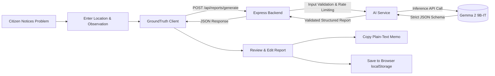

# GroundTruth 🌿

> **Notice it. Document it. Do something about it.**

An AI-powered public-space reporting assistant built for open-source civic tech. GroundTruth enables students, residents, and campus community members to transform raw, everyday observations of physical hazards, infrastructure decay, accessibility obstacles, and sanitation failures into structured, professional, actionable civic reports.

---

## 📑 Table of Contents

- [Problem Statement](#problem-statement)
- [Product Vision & Core Features](#product-vision--core-features)
- [Architecture & Workflow](#architecture--workflow)
- [Technical Stack](#technical-stack)
- [AI Model Integration](#ai-model-integration)
- [Project Structure](#project-structure)
- [Local Development Setup](#local-development-setup)
- [Environment Configuration](#environment-configuration)
- [Deployment Guide (Vercel + Render)](#deployment-guide-vercel--render)
- [Privacy & Responsible AI](#privacy--responsible-ai)
- [Testing & Acceptance Verification](#testing--acceptance-verification)
- [Future Improvements](#future-improvements)

---

## 🎯 Problem Statement

Every day, people walk past blocked wheelchair ramps, overflowing garbage bins, broken streetlights, cracked sidewalks, and leaking water pipes. While many notice these problems, very few report them because:
1. **Reporting friction:** Civic and campus maintenance forms often demand formal technical terminology, legal categorization, and exhaustive specifications.
2. **Lack of structure:** Vague or disorganized observations are frequently deprioritized or misunderstood by maintenance teams.
3. **Privacy concerns:** Many users hesitate to install heavyweight native municipal apps that demand continuous background GPS tracking and personal account registration.

**GroundTruth** solves this by offering a lightweight, local-first web app that takes plain-text descriptions, structures them using an instruction-tuned open-weight AI model (**Gemma 2 9B-IT**), identifies missing details to verify, and equips the reporter with a clean memo ready to share with responsible coordinators.

---

## 🌟 Core Features

- **No Account Required:** Completely open civic tool. No sign-up, no passwords, no personal data harvesting.
- **6 Civic Categories:** Accessibility, Infrastructure, Waste Management, Water Issues, Public Facilities, and Other.
- **Privacy-Preserving Location Entry:** Free-text location or landmark description without mandatory GPS access permissions.
- **AI-Powered Structuring:** Converts casual observations into concise, professional summaries with recommended next steps.
- **Demonstration Mode ("Try an Example"):** Instantly pre-fills realistic civic scenarios (e.g., blocked ramp, overflowing recycling station, leaking water fountain) for testing and hackathon evaluation.
- **Fully Editable Reports:** Reviewers can refine generated titles, descriptions, and recommended actions directly before saving or sharing.
- **Single-Click Formatted Copy:** Formats reports into clean, plain-text civic memos ready for email, ticketing systems, or community boards.
- **Local-First History ("My Reports"):** Saves reports in browser `localStorage` with search, category filtering, and deletion controls.
- **Multilingual Support:** English output with experimental Hindi translation support.
- **Accessible Civic Design:** Warm off-white palette (`#F8F9F6`), charcoal typography (`#1A221E`), and public-space green accents (`#2D6A4F`).

---

## 📐 Architecture & Workflow

### End-to-End Civic Reporting Flow



---

## 🛠️ Technical Stack

### Frontend
- **Framework:** React 18
- **Build Tool:** Vite 6
- **Styling:** Vanilla CSS3 using custom CSS variables (Warm Civic Design System)
- **Icons:** Lucide React
- **Storage:** Browser `localStorage` (Zero external database tracking)

### Backend
- **Runtime:** Node.js (v18+)
- **Server:** Express.js (ES Modules)
- **Middleware:** In-memory sliding window rate limiter, CORS, request body validator, centralized error handler
- **HTTP Client:** Native `fetch` with AbortController timeout

### AI Model
- **Model:** `gemma2-9b-it` (Google Gemma 2 9B Instruction-Tuned open-weight model)
- **Protocol:** Standard OpenAI-compatible Chat Completion API (`POST /chat/completions`)
- **Supported Providers:** Groq (`https://api.groq.com/openai/v1`), OpenRouter (`https://openrouter.ai/api/v1`), Together AI, or local Ollama (`http://localhost:11434/v1`)

---

## 🧠 AI Model Integration

### Model Justification
GroundTruth utilizes **Gemma 2 9B-IT**, Google’s state-of-the-art open-weight instruction-tuned model. It offers high reasoning precision, excellent spatial comprehension, adherence to system constraints, and rapid inference when accessed via hosted providers such as Groq or OpenRouter.

### System Prompt & Safety Constraints
The model operates under strict civic guidelines:
1. **Preserve observations faithfully:** The model never invents damages, hazards, or facts not mentioned by the reporter.
2. **Objective terminology:** Uses neutral, professional municipal language without inflammatory claims.
3. **Distinguish facts from recommendations:** Separates the observed situation from the suggested next action.
4. **Identify items to verify:** Automatically flags details the reporter might want to double-check (e.g., room numbers, exact times, whether access is partially passable).
5. **No authoritative safety claims:** Never claims that an issue has been inspected, certified, or resolved.
6. **No legal or liability assertions:** Focuses exclusively on physical observations.

### Structured Output Schema
```json
{
  "title": "Short descriptive report title",
  "category": "Accessibility",
  "location": "North Campus Library, Main East Entrance",
  "description": "Concrete wheelchair ramp is blocked by stacked wooden pallets...",
  "suggestedAction": "Notify campus facilities management to clear access pathway.",
  "missingInformation": [
    "Whether alternative ramp access is available on the west side."
  ]
}
```

---

## 📂 Project Structure

```
GroundTruth/
├── client/
│   ├── public/
│   ├── src/
│   │   ├── components/
│   │   │   ├── CategoryCard.jsx     # Interactive civic category cards
│   │   │   ├── Modal.jsx            # Accessible dialog component
│   │   │   ├── Navbar.jsx           # Header with live API connection pill
│   │   │   ├── PrivacyModal.jsx     # Privacy & Responsible AI disclosure
│   │   │   ├── ReportCard.jsx       # Report display, inline editing & copy
│   │   │   └── Toast.jsx            # Toast alerts for clipboard & saving
│   │   ├── pages/
│   │   │   ├── CreateReportPage.jsx # Form, demonstration mode, generation
│   │   │   ├── HomePage.jsx         # Hero, journey graphic, category grid
│   │   │   └── MyReportsPage.jsx    # LocalStorage report vault & search
│   │   ├── services/
│   │   │   ├── api.js               # Backend API client with timeout
│   │   │   └── storage.js           # Safe browser localStorage manager
│   │   ├── utils/
│   │   │   ├── formatters.js        # Plain-text memo formatter & helpers
│   │   │   └── sampleScenarios.js   # Demonstration mode scenarios
│   │   ├── App.jsx                  # Root state & navigation
│   │   ├── index.css                # Civic-tech design system & variables
│   │   └── main.jsx                 # React root mounting
│   ├── index.html                   # Semantic HTML5 entry with Google Fonts
│   ├── package.json                 # Client dependencies & scripts
│   ├── vite.config.js               # Vite bundler configuration
│   └── .env.example                 # Frontend environment template
├── server/
│   ├── middleware/
│   │   ├── errorHandler.js          # Centralized safe error handler
│   │   ├── rateLimiter.js           # In-memory sliding window rate limiter
│   │   └── validator.js             # Input validation & sanitization
│   ├── routes/
│   │   └── reportRoutes.js          # POST /api/reports/generate
│   ├── services/
│   │   └── aiService.js             # Hosted Gemma model integration & parser
│   ├── index.js                     # Express entry point & health check
│   ├── package.json                 # Server dependencies & scripts
│   └── .env.example                 # Backend environment template
├── .gitignore                       # Git exclusion rules (.env, node_modules)
└── README.md                        # Documentation
```

---

## 🚀 Local Development Setup

### Prerequisites
- **Node.js:** v18.0.0 or higher
- **npm:** v9.0.0 or higher
- An API key for an OpenAI-compatible provider hosting Gemma (e.g., [Groq Cloud](https://console.groq.com/) or [OpenRouter](https://openrouter.ai/)).

### 1. Clone & Install Dependencies

```bash
# Clone repository
git clone https://github.com/your-username/GroundTruth.git
cd GroundTruth

# Install server dependencies
cd server
npm install

# Install client dependencies
cd ../client
npm install
```

### 2. Configure Backend Environment

In the `server` directory, create a `.env` file based on `.env.example`:

```bash
cd ../server
cp .env.example .env
```

Edit `server/.env`:
```env
PORT=5000
CORS_ORIGIN=http://localhost:5173
AI_API_KEY=gsk_your_groq_api_key_here
AI_MODEL=gemma2-9b-it
AI_API_BASE_URL=https://api.groq.com/openai/v1
AI_REQUEST_TIMEOUT_MS=30000
```

> **Note on Providers:**
> - **Groq (Recommended):** Set `AI_API_BASE_URL=https://api.groq.com/openai/v1`, `AI_MODEL=gemma2-9b-it`, and provide your `gsk_...` key.
> - **OpenRouter:** Set `AI_API_BASE_URL=https://openrouter.ai/api/v1`, `AI_MODEL=google/gemma-2-9b-it`, and provide your `sk-or-...` key.
> - **Local Ollama:** Set `AI_API_BASE_URL=http://localhost:11434/v1`, `AI_MODEL=gemma2:9b`, and `AI_API_KEY=ollama`.

### 3. Start Backend Server

```bash
cd server
npm start
```
The server will start at `http://localhost:5000`. You can verify health at `http://localhost:5000/api/health`.

### 4. Start Frontend Client

In a separate terminal:
```bash
cd client
npm run dev
```
Open your browser at `http://localhost:5173`.

---

## 🔒 Security & Safe AI Implementation

1. **API Key Isolation:** The AI key is strictly maintained on the Node.js server. The Vite frontend never receives or references `AI_API_KEY`.
2. **Server-Side Input Sanitization:** Rejects payload exceeding 100kb, enforces strict category enums, trims whitespace, and validates string boundaries.
3. **In-Memory Rate Limiting:** Enforces a per-IP sliding limit on `/api/reports/generate` to protect against token exhaustion.
4. **JSON Sanitization & Extraction:** Robust parser strips potential conversational wrapper text and validates JSON keys before passing data to the client.
5. **No Dangerous HTML Injection:** All user observations and AI outputs are rendered through React’s escaped text tree.

---

## 🌐 Deployment Guide (Vercel + Render)

### Backend Deployment (Render)
1. Push your repository to GitHub.
2. In Render, select **New Web Service** and link your repo.
3. Set **Root Directory** to `server`.
4. Set **Build Command** to `npm install`.
5. Set **Start Command** to `npm start`.
6. Add the following **Environment Variables**:
   - `PORT=5000`
   - `CORS_ORIGIN=https://your-groundtruth-app.vercel.app`
   - `AI_API_KEY=your_hosted_inference_api_key`
   - `AI_MODEL=gemma2-9b-it`
   - `AI_API_BASE_URL=https://api.groq.com/openai/v1`
7. Click **Create Web Service**. Your service URL will be something like `https://groundtruth-api.onrender.com`.

### Frontend Deployment (Vercel)
1. In Vercel, select **Add New Project** and import your repo.
2. Set **Root Directory** to `client`.
3. Set **Framework Preset** to `Vite`.
4. Add the following **Environment Variable**:
   - `VITE_API_BASE_URL=https://groundtruth-api.onrender.com`
5. Click **Deploy**.

---

## ⚖️ Privacy & Responsible AI Disclosures

- **Local-First Storage:** All reports are stored in browser `localStorage`. No database stores user observations.
- **Inference Transmission:** Raw descriptions are transmitted over HTTPS to the backend and the chosen inference provider solely to generate the report.
- **No Automatic Filing:** GroundTruth is a drafting tool and does not transmit reports directly to emergency services or city authorities.
- **Human-in-the-Loop:** Users are explicitly prompted to review and edit AI outputs before copying or submitting.

---

## 🧪 Acceptance Testing Summary

| Test Case | Method | Result |
| :--- | :--- | :--- |
| **Backend Startup & Health Check** | `GET /api/health` | **PASSED** (HTTP 200, status: ok) |
| **Frontend Production Build** | `npm run build` | **PASSED** (Built in 10.9s, 0 errors) |
| **Form Validation** | Missing required fields | **PASSED** (Inline errors, 400 rejection) |
| **Missing API Key Handling** | Request without key | **PASSED** (Graceful 503 + UI guidance) |
| **Demonstration Mode** | Sample scenario load | **PASSED** (Populates form with sample tag) |
| **Report Review & Inline Edit** | Edit report fields | **PASSED** (Modifies title, desc, action) |
| **Copy to Clipboard** | Copy formatted memo | **PASSED** (Formatted text + toast notification) |
| **LocalStorage Persistence** | Save report & reload | **PASSED** (Persists across page navigation) |
| **Search & Category Filter** | Filter by type & query | **PASSED** (Real-time keyword matching) |
| **Visual & Responsive UX** | Desktop & Mobile views | **PASSED** (Clean layout, accessible colors) |

---

## 🔮 Future Improvements

- **Photo Attachment & Image Analysis:** Integrate multi-modal Gemma vision models to extract damage notes directly from uploaded photos.
- **Export Formats:** Add one-click export to PDF and CSV formats for campus facility spreadsheets.
- **Offline PWA Support:** Cache demonstration scenarios and offline form drafts via Service Workers.
- **Municipal Format Templates:** Adapt generated memo structure to standard Open311 civic API schemas.

---

## 📄 License

GroundTruth is open-source software licensed under the MIT License.
